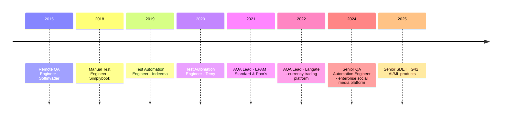
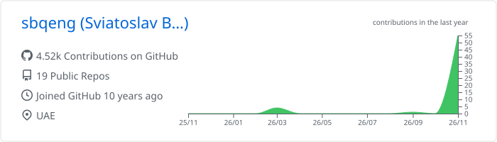
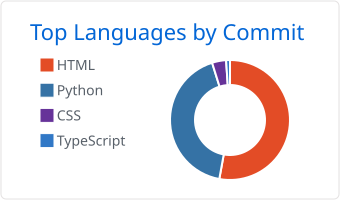

<h1 align="center">Hi, I'm Sviatoslav Bordovskyi </h1>

<h3 align="center">Senior SDET · ML &amp; AI Testing · Test Automation Architect</h3>

  I build test automation that teams trust: frameworks from scratch, fast CI pipelines, 
  and quality strategy for fintech, enterprise and AI/ML products. 11+ years in Quality Engineering.

  
  
  
  
  <a href="https://x.com/sbordovskyi"><picture>
    <source media="(prefers-color-scheme: dark)" srcset="https://img.shields.io/badge/X-FFFFFF?style=for-the-badge&logo=x&logoColor=black"/>
    
  </picture></a>

---

## 📊 Impact in numbers

<table align="center">
  <tr>
    <td align="center" valign="top" width="25%"><h2>11+</h2>years in QA &amp; test automation</td>
    <td align="center" valign="top" width="25%"><h2>6,000+</h2>tests has been automated on Enterprise project to run every night</td>
    <td align="center" valign="top" width="25%"><h2>85%+</h2>automated test coverage achieved</td>
    <td align="center" valign="top" width="25%"><h2>3M+</h2>daily trading operations kept under test</td>
  </tr>
  <tr>
    <td align="center" valign="top"><h2>−60%</h2>regression cycle time, 2× faster releases</td>
    <td align="center" valign="top"><h2>−40%</h2>fewer bugs on a fintech platform</td>
    <td align="center" valign="top"><h2>700+</h2>FIX API &amp; WebSocket tests built from scratch</td>
    <td align="center" valign="top"><h2>2×</h2>AQA Lead roles (EPAM, Langate)</td>
  </tr>
</table>

  

## 🚀 Career path

In QA since **October 2015**: from my first remote QA role to Lead/Senior SDET leading AI/ML quality.

## ✨ About me

I'm a **Senior SDET at [G42](https://www.g42.ai/)** in the UAE, where I architect and lead the test automation strategy for AI/ML-driven products across UI, API, WebSockets and backend systems. I own end-to-end quality of ML pipelines, from data validation and model inference to regression, and I define AI testing standards for accuracy, drift, bias and behavioural consistency.

Before that I led automation in **fintech**: as **AQA Lead at EPAM** on the **Standard & Poor's** investor platform, and as **AQA Lead at Langate** on a currency trading platform handling 3M+ operations a day. I also built a Selenium + Python and Playwright + TypeScript framework from scratch for an enterprise social media platform with 500k+ daily visits.

What I bring to a team:

- 🏗️ **Frameworks from scratch** for web, mobile, API, WebSockets and FIX API
- ⚙️ **CI/CD-first testing** with GitHub Actions, Jenkins, GitLab CI, CircleCI and Azure DevOps
- 🤖 **AI/ML quality**: model and data validation, LLM and agent evaluation with DeepEval and LangChain
- 🧑‍🏫 **Mentoring and leadership**: onboarding engineers, setting coding standards, running pairing sessions
- 📈 **Quality metrics** that help product teams make release decisions

🌱 Currently learning: AI agents, LangChain, DeepEval and advanced TypeScript. 
🎓 Master's degree, Lviv University of Trade and Economics. 
⚡ Fun fact: I ❤️ 🐕s and 🚲.

## 🏆 Awards and achievements

- 🥇 **AQA Lead at EPAM** on the Standard & Poor's fintech platform: cut regression time by **60%**, shipped builds **2× faster**, reduced bugs by **40%** and raised team coverage from **35% to 75%**
- 🥇 **AQA Lead at Langate**: led the framework for a currency trading platform with **3M+ operations per day**, built **700+ FIX API and WebSocket tests**, and lifted coverage by **30%** with Playwright + TypeScript
- 🧪 **6,000+ nightly automated tests** at **85%+ coverage** for a platform with 500k+ daily visits, while cutting automation support time by **1.5×**
- 🤝 **Team growth**: onboarded and mentored new engineers through weekly check-ins and pairing, improving team velocity by **15%**
- 🔁 **1,000+ manual cross-browser tests automated**, reducing manual testing time by **72%**
- 🇺🇦 Kept delivering across multiple projects while living in Ukraine during the war
- 🌍 **Recommended by engineers and managers around the world**. [Read the recommendations on LinkedIn](https://www.linkedin.com/in/sviatoslavbordovskyi/details/recommendations/)
- 📜 **Certified** in management, Selenium, Python, Postman, Robot Framework and web development. [See all certifications](https://www.linkedin.com/in/sviatoslavbordovskyi/details/certifications)

## 🛠️ Languages and tools

**Languages** 

**Test automation** 

**API and protocols** 

**CI/CD and cloud** 

**Databases** 

**AI tooling** 

**Practices**: OOP, SOLID, KISS, Page Object Model, Facade and Factory patterns, BDD, TDD

## 📈 GitHub stats

  <picture>
    <source media="(prefers-color-scheme: dark)" srcset="./profile-summary-card-output/github_dark/0-profile-details.svg"/>
    
  </picture>

  <picture>
    <source media="(prefers-color-scheme: dark)" srcset="./profile-summary-card-output/github_dark/1-repos-per-language.svg"/>
    
  </picture>
  <picture>
    <source media="(prefers-color-scheme: dark)" srcset="./profile-summary-card-output/github_dark/2-most-commit-language.svg"/>
    
  </picture>

## 🧩 Open source

All my personal projects are open source:

- [UI Selenium Pytest Automation](https://github.com/sbqeng/UI_Selenium_Pytest_Automation): a complete framework with reports, examples and a GitHub Actions workflow
- [Geolocation program](https://github.com/sbqeng/geolocation_program): finds the latitude and longitude of any city or zip code
- [Personal website](https://sbqeng.github.io): my mission, what I do and how to reach me
- [Color flipper](https://github.com/sbqeng/Color_flipper): generate the right color for your component in one click
- [Hangman game](https://github.com/sbqeng/Hangman_game): guess the word before it's too late

[⏩ See all repositories](https://github.com/sbqeng?tab=repositories)

  

